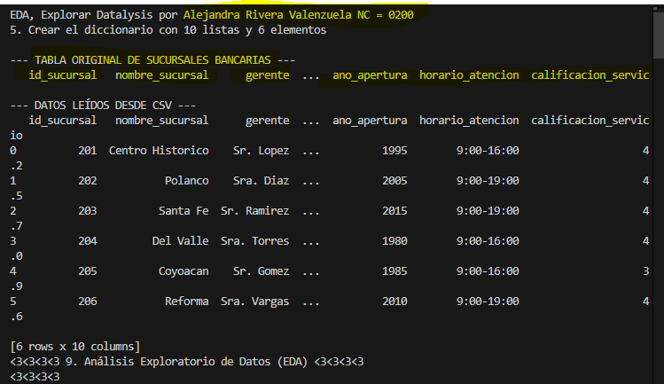
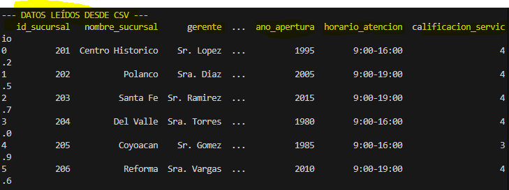
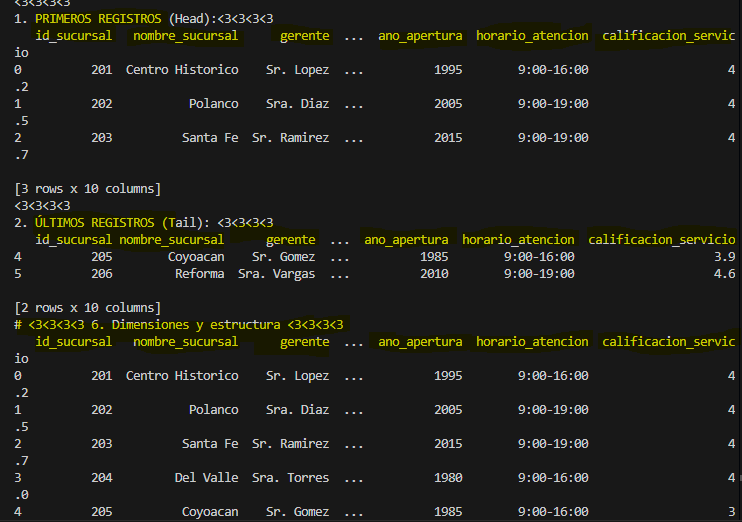
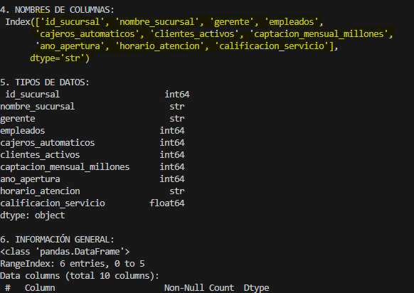
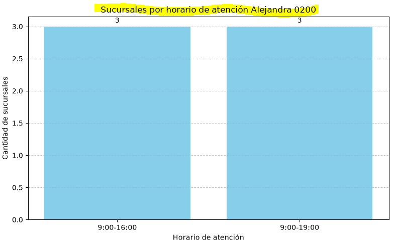
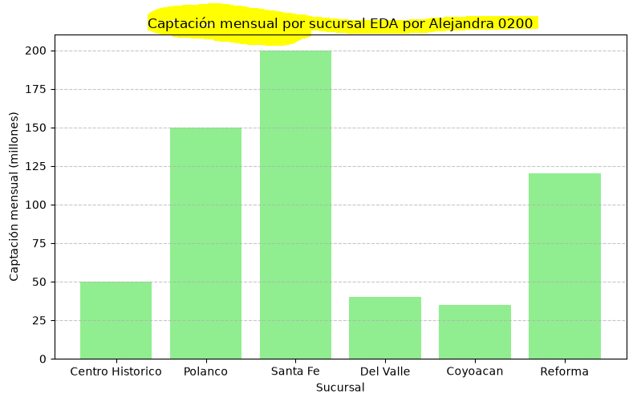
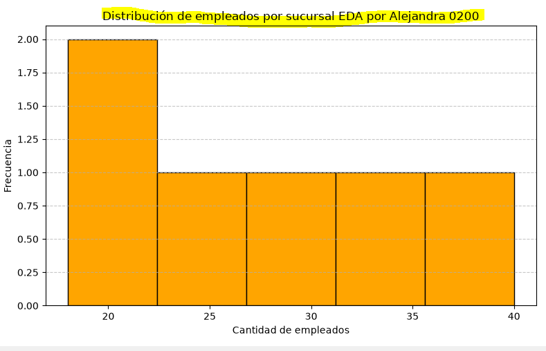
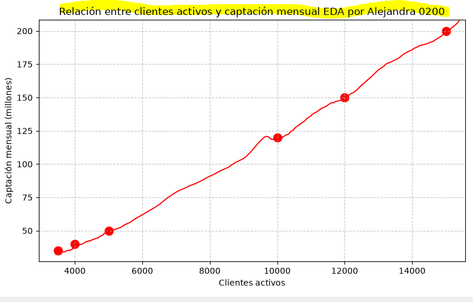
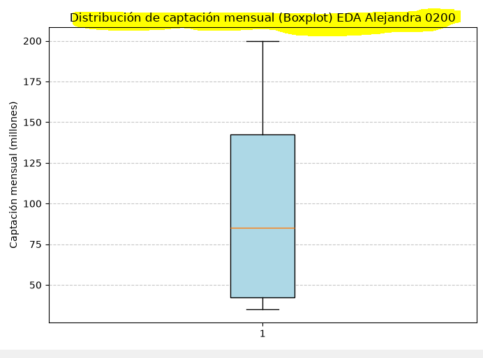
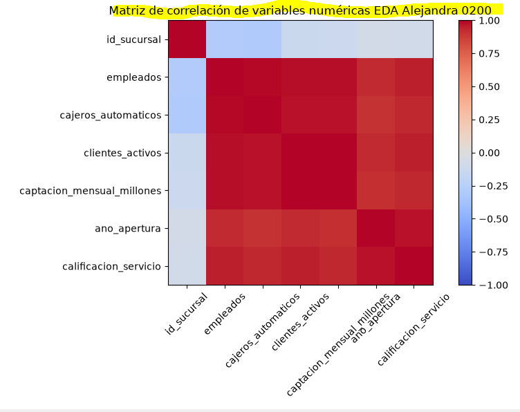

# UIII Act3  Importación y descripción de datos con Pandas 
# Alejandra Rivera Valenzuela NC = 0200
# Numero de lista = 48 
# sucursales_bancarias 
# 📊 UIII Act3: Importación y Descripción de Datos
> **🎓 Asignatura:** Soluciona problemas de Machine Learning  
> **📚 Nivel:** Tercer semestre de preparatoria  
> **🤖 Especialidad:** Inteligencia Artificial  
> **📈 Dificultad:** Cero a principiante  
> **🐍 Lenguaje:** Python  
> **🛠️ Herramientas:** Visual Studio Code, Pandas, Matplotlib y CSV 
# SUCURSALES BANCARIAS 
# sucursales_bancarias

# Tabla original de socursales

# primer y ultimo registro 

# Dimensiones 

# _

# _

# _

# _ 

# _ 

# _
